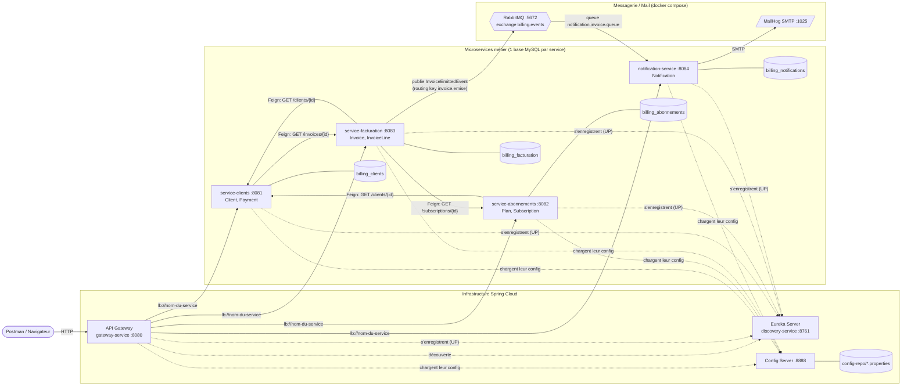
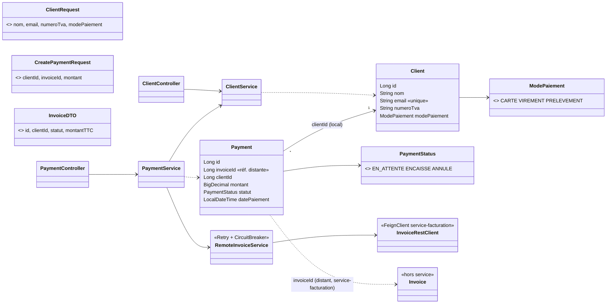
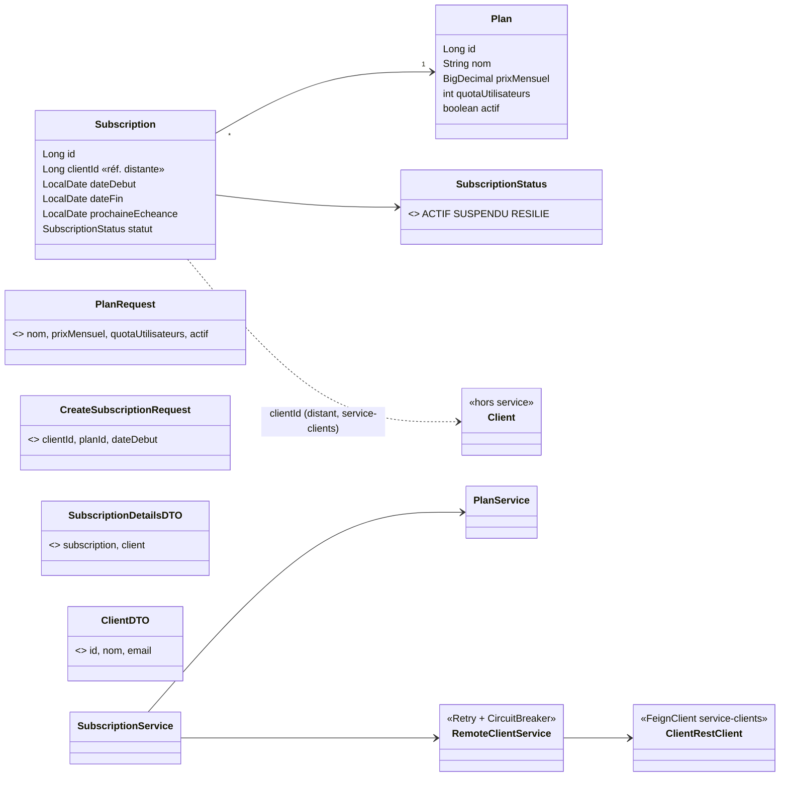
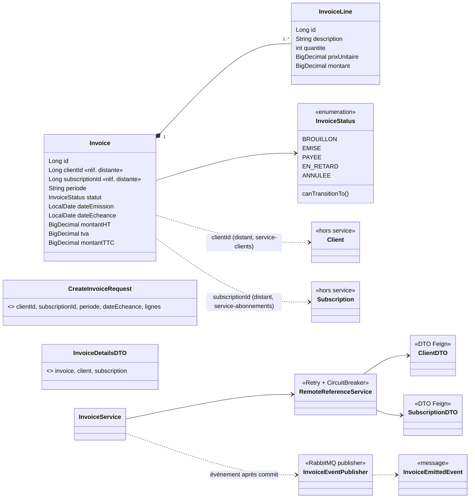
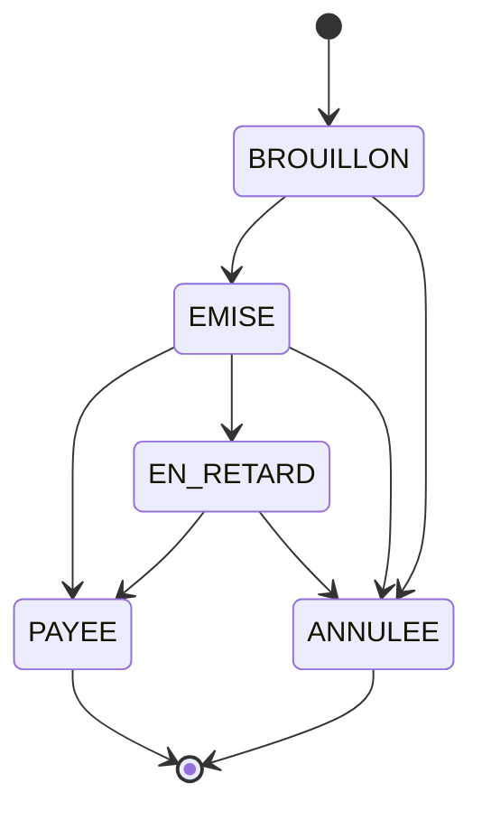
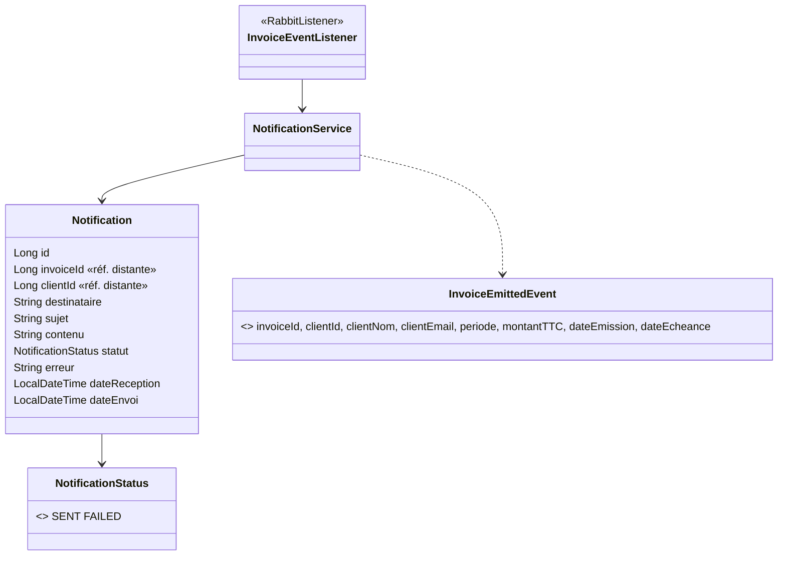

# Billing Microservices

Plateforme de facturation en **architecture microservices** : clients et paiements, abonnements et plans, facturation avec TVA,
notifications par e-mail. Java 17 · Spring Boot 3.3 · Spring Cloud 2023.0 · Maven · MySQL · RabbitMQ.

> Ce document couvre le jalon **V0** (conception & documentation) et sert de guide de lancement pour V1 à V6.

---

## Sommaire

1. [Prérequis](#1-prérequis)
2. [Schéma d'architecture globale](#2-schéma-darchitecture-globale)
3. [Les modules](#3-les-modules)
4. [Diagrammes de classes par microservice (et références distantes)](#4-diagrammes-de-classes-par-microservice)
5. [Instructions : démarrage pas à pas](#5-instructions--démarrage-pas-à-pas)
6. [Endpoints](#6-endpoints)
7. [Communication entre services](#7-communication-entre-services)
8. [Flux asynchrone (RabbitMQ)](#8-flux-asynchrone-rabbitmq)
9. [Résilience, erreurs et idempotence (V6)](#9-résilience-erreurs-et-idempotence-v6)
10. [Configuration externalisée (Config Server)](#10-configuration-externalisée-config-server)
11. [Tests avec Postman](#11-tests-avec-postman)
12. [Dépannage](#12-dépannage)

---

## 1. Prérequis

| Outil | Version | Usage |
|---|---|---|
| JDK | 17 | compilation et exécution |
| Maven | 3.9+ | build (`mvn clean package`) – ou le Maven intégré d'IntelliJ |
| Docker Desktop | récent | MySQL, RabbitMQ et MailHog via `docker compose up -d` |
| Postman | récent | validation : importer `postman/Billing-Microservices.postman_collection.json` |
| IntelliJ IDEA | 2025.x | recommandé (projet Maven multi-modules ouvert depuis le `pom.xml` racine) |

Ports utilisés : `3306` MySQL · `8761` Eureka · `8888` Config Server · `8080` Gateway · `8081` clients ·
`8082` abonnements · `8083` facturation · `8084` notification · `5672`/`15672` RabbitMQ · `1025`/`8025` MailHog.

---

## 2. Schéma d'architecture globale



**Principes d'architecture**

- **Database per Service** : chaque service possède sa propre base MySQL et son propre utilisateur ; aucun service n'a de droit sur la base d'un autre.
- **Références distantes = simples identifiants** (`clientId`, `planId`, `subscriptionId`, `invoiceId`) : pas de clé étrangère
  entre bases. La cohérence est assurée au moment de la création par un appel **OpenFeign** de validation (V4).
- **Couches** dans chaque service : `Controller → Service → Repository → Entity`, avec des **DTO** pour les requêtes entrantes
  et les réponses composées.
- **Découverte** : aucune URL en dur entre services, on appelle `service-clients`, `service-abonnements`… résolus par Eureka.
- **Asynchrone** : la facturation ne connaît pas le service de notification ; elle publie un événement, RabbitMQ le transporte.

---

## 3. Les modules

| Module | Port | Rôle | Base |
|---|---|---|---|
| `eureka` (`discovery-service`) | 8761 | Annuaire des services (Service Discovery) | – |
| `config-server` | 8888 | Sert les fichiers de `config-repo/` aux autres services | – |
| `gateway1` (`gateway-service`) | 8080 | Point d'entrée unique, routage + load balancing | – |
| `service-clients` | 8081 | CRUD `Client`, `Payment` (encaisser / annuler) | `billing_clients` |
| `service-abonnements` | 8082 | CRUD `Plan`, `Subscription` (résilier) | `billing_abonnements` |
| `service-facturation` | 8083 | `Invoice` + `InvoiceLine`, machine à états, HT / TVA / TTC, publisher RabbitMQ | `billing_facturation` |
| `notification-service` | 8084 | Consumer RabbitMQ, envoi des e-mails, historique des notifications | `billing_notifications` |

---

## 4. Diagrammes de classes par microservice

Les flèches en pointillés `..>` représentent une **référence distante** : seul l'identifiant est stocké localement,
l'objet réel vit dans un autre microservice et est consulté par OpenFeign.

### 4.1 service-clients



### 4.2 service-abonnements



### 4.3 service-facturation



Contrainte d'unicité `(subscriptionId, periode)` : une seule facture par abonnement et par période (base de l'idempotence).

Machine à états :



### 4.4 notification-service



---

## 5. Instructions : démarrage pas à pas

### 5.1 Build

```bash
mvn clean package -DskipTests
```

> Ouvrir le `pom.xml` **racine** dans IntelliJ : les 7 modules sont importés automatiquement.

### 5.2 Infrastructure Docker (MySQL, V5)

```bash
cp .env.example .env
# Remplacer les mots de passe exemples dans .env avant le premier démarrage.
docker compose up -d
```

Docker crée quatre bases MySQL (`billing_clients`, `billing_abonnements`, `billing_facturation`,
`billing_notifications`) et un utilisateur limité à chaque base. L'initialisation est exécutée à la première création
du volume MySQL. Les mots de passe de `.env` ne doivent pas être commités.

MySQL : `localhost:3306` · RabbitMQ : <http://localhost:15672> (guest / guest) ·
Boîte mail de test MailHog : <http://localhost:8025>

### 5.3 Ordre de démarrage (IntelliJ : lancer chaque `*Application`, ou `java -jar`)

| # | Module | Attendre que… |
|---|---|---|
| 1 | `eureka` (`EurekaApplication`) | <http://localhost:8761> s'affiche |
| 2 | `config-server` (`ConfigServerApplication`) | <http://localhost:8888/service-clients/default> renvoie du JSON |
| 3 | `service-clients`, `service-abonnements`, `service-facturation`, `notification-service` (dans n'importe quel ordre) | ils apparaissent **UP** dans Eureka |
| 4 | `gateway1` (`Gateway1Application`) | route `http://localhost:8080/clients` répond |

Raccourci en ligne de commande depuis la racine, exemple pour un service :

```bash
cd service-clients
mvn spring-boot:run
```

### 5.4 Config Server : GitHub

Le Config Server clone `https://github.com/houdachiker/billing-microservices.git`, branche `main`, et lit le dossier
`config-repo/`. Il n'utilise pas de configuration locale de secours. Toute modification de configuration doit donc être
commitée et poussée sur GitHub avant le démarrage ou le prochain rafraîchissement du Config Server.

Les services importent la configuration distante de façon obligatoire : ils ne démarrent pas avec une configuration locale
si le Config Server est indisponible.

Les URL, utilisateurs et noms des bases sont dans `config-repo/<service>.properties`. Les mots de passe ne sont pas
stockés dans ce dépôt : les services lisent les variables d'environnement `DB_CLIENTS_PASSWORD`,
`DB_ABONNEMENTS_PASSWORD`, `DB_FACTURATION_PASSWORD` ou `DB_NOTIFICATIONS_PASSWORD`. `.env` sert à Docker Compose;
pour lancer les applications depuis IntelliJ, définir le mot de passe correspondant dans la configuration d'exécution
de chaque service. `MYSQL_HOST` et `MYSQL_PORT` ont les valeurs par défaut `localhost` et `3306`.

Chaque service définit aussi un `server.port` par défaut dans son `application.properties`.

### 5.5 Plusieurs instances (load balancing)

Dupliquer la configuration de `service-clients` avec *VM options* `-Dserver.port=9081`, la lancer, puis appeler plusieurs fois
`GET http://localhost:8080/service-clients/instance-info` : la réponse alterne entre les ports `8081` et `9081`.

---

## 6. Endpoints

Tous accessibles directement (ports 808x) **ou** via la gateway (`:8080`, routes statiques ci-dessous ou dynamiques
`/<nom-du-service>/…`).

| Service | Endpoints |
|---|---|
| **clients** (`/clients/**`, `/payments/**`) | `GET/POST /clients` · `GET/PUT/DELETE /clients/{id}` · `GET/POST /payments` · `GET /payments/{id}` · `PATCH /payments/{id}/encaisser` · `PATCH /payments/{id}/annuler` · `GET /instance-info` |
| **abonnements** (`/plans/**`, `/subscriptions/**`) | `GET/POST /plans` · `GET/PUT/DELETE /plans/{id}` · `GET/POST /subscriptions` · `GET /subscriptions/{id}` · **`GET /subscriptions/{id}/details`** · `PATCH /subscriptions/{id}/resilier` |
| **facturation** (`/invoices/**`) | `GET/POST /invoices` · `GET /invoices/{id}` · **`GET /invoices/{id}/details`** · `PATCH /invoices/{id}/status?statut=EMISE\|PAYEE\|EN_RETARD\|ANNULEE` |
| **notification** (`/notifications/**`) | `GET /notifications` · `GET /notifications/{id}` · `GET /notifications/invoice/{invoiceId}` |
| Supervision | `GET /actuator/health`, `/actuator/circuitbreakers`, `/actuator/retries` (clients, abonnements, facturation) |

Exemple :

```bash
curl -X POST localhost:8080/clients -H "Content-Type: application/json" \
  -d '{"nom":"Acme SARL","email":"acme@mail.com","numeroTva":"FR123","modePaiement":"CARTE"}'
  -d '{"nom":"Pro","prixMensuel":30,"quotaUtilisateurs":5,"actif":true}'
curl -X POST localhost:8080/subscriptions -H "Content-Type: application/json" -d '{"clientId":1,"planId":1}'
curl -X POST localhost:8080/invoices -H "Content-Type: application/json" \
  -d '{"clientId":1,"subscriptionId":1,"periode":"2026-11","dateEcheance":"2026-12-05",
       "lignes":[{"description":"Plan Pro - novembre","quantite":1,"prixUnitaire":30}]}'
curl -X PATCH "localhost:8080/invoices/1/status?statut=EMISE"      # déclenche le mail de notification
curl localhost:8080/invoices/1/details                              # facture + client + abonnement
```

---

## 7. Communication entre services

Clients OpenFeign (interfaces typées, DTO dédiés, nom de service résolu par Eureka) :

| Appelant | Cible | Appel | Utilisation |
|---|---|---|---|
| service-abonnements | service-clients | `GET /clients/{id}` | valider `clientId` à la création d'un abonnement ; `GET /subscriptions/{id}/details` |
| service-facturation | service-clients | `GET /clients/{id}` | valider `clientId` ; `details` ; e-mail du destinataire |
| service-facturation | service-abonnements | `GET /subscriptions/{id}` | valider `subscriptionId` (existe, appartient au client, **ACTIF**) ; `details` |
| service-clients | service-facturation | `GET /invoices/{id}` | valider `invoiceId` à la création d'un paiement (appartient au client, EMISE ou EN_RETARD) |

**Validation préalable** : si la référence distante est invalide, la création échoue (404 ou 409) et **rien n'est enregistré**.

**DTO composés (consultation enrichie)** : `SubscriptionDetailsDTO` (abonnement + plan + client) et `InvoiceDetailsDTO`
(facture + client + abonnement/plan).

---

## 8. Flux asynchrone (RabbitMQ)

```
PATCH /invoices/{id}/status?statut=EMISE
   └─ service-facturation : change l'état, commit en base
        └─ (après commit) InvoiceEventPublisher ─► exchange "billing.events" [routing key invoice.emise]
              └─ RabbitMQ : queue durable "notification.invoice.queue"
                    └─ notification-service : InvoiceEventListener (@RabbitListener)
                          └─ NotificationService : construit le mail, l'envoie (SMTP), enregistre Notification (SENT / FAILED)
GET /notifications/invoice/{id}  ─► confirmation de l'envoi
```

- Publisher : `service-facturation/.../messaging/InvoiceEventPublisher` (`@TransactionalEventListener(AFTER_COMMIT)`).
- Consumer : `notification-service/.../listener/InvoiceEventListener`.
- Messages en **JSON**, queue **durable** (aucun message perdu si le consumer est arrêté), consumer **idempotent**
  (un doublon n'envoie pas deux mails).
- Mail : MailHog par défaut (`spring.mail.host=localhost`, port `1025`) ; pour Gmail, voir les commentaires de
  `config-repo/notification-service.properties`.

---

## 9. Résilience, erreurs et idempotence (V6)

| Exigence | Réalisation |
|---|---|
| **Circuit Breaker** | Resilience4j `@CircuitBreaker` sur **4 appels Feign** : `clientService` & `subscriptionService` (facturation), `clientService` (abonnements), `invoiceService` (clients). Fenêtre 6 appels, ouverture à 50 % d'échecs, 15 s en OPEN, puis HALF_OPEN. Fallback : `ServiceUnavailableException` → 503. |
| **Retry** | `@Retry` : 3 tentatives, 500 ms d'attente, uniquement sur erreurs techniques (service arrêté, 5xx, timeout) – jamais sur un 404 métier. |
| **Timeout** | Feign : `connect-timeout=2000`, `read-timeout=3000` (`config-repo/*.properties`). |
| **Gestion centralisée des erreurs** | `@RestControllerAdvice GlobalExceptionHandler` dans chaque service : 404, 409, 400 (validation, JSON, enum), 405, 503, 500, format JSON uniforme `{timestamp,status,error,message}`. Aucun `try/catch` dans les contrôleurs. |
| **Idempotence des créations** | Facture : `(subscriptionId, periode)` unique – rejouer la requête renvoie la facture existante (**200** + `Idempotent-Replay: true`, au lieu de 201). Abonnement : un client a au plus un abonnement ACTIF par plan (même principe). Consumer RabbitMQ : une facture déjà notifiée n'est pas renotifiée. |

Supervision : `GET :8083/actuator/circuitbreakers`.

---

## 10. Configuration externalisée (Config Server)

Chaque service n'embarque que deux lignes :

```properties
spring.application.name=service-clients
spring.config.import=optional:configserver:http://localhost:8888
```

Le reste (port, base de données, Eureka, timeouts, Resilience4j, RabbitMQ, mail, routes de la gateway) est dans
`config-repo/<spring.application.name>.properties` :

`service-clients.properties` · `service-abonnements.properties` · `service-facturation.properties` ·
`notification-service.properties` · `gateway-service.properties`.

Le nom de chaque fichier est identique au `spring.application.name` du service concerné.

---

## 11. Tests avec Postman

Importer `postman/Billing-Microservices.postman_collection.json` (variables déjà définies : `gateway`, `clients`, `abonnements`,
`facturation`, `notification`, `eureka`, `config`). Chaque requête contient des tests automatiques.

Ordre conseillé (Collection Runner, un dossier après l'autre) : **V1 → V2 & V3 → V4 → V5 → V6**
(le dossier « Circuit Breaker » de V6 est manuel : arrêter `service-clients` d'abord).

---

## 12. Dépannage

| Symptôme | Cause / solution |
|---|---|
| `Port 8080 already in use` | Un autre programme (ex. conteneur Docker) occupe 8080 : l'arrêter, ou lancer la gateway avec `--server.port=8090` et adapter la variable Postman `gateway`. |
| Un service ne trouve pas sa config | Démarrer le Config Server et vérifier qu'il peut cloner le dépôt GitHub configuré. Les services exigent la configuration distante. |
| Modification de `config-repo` ignorée | Vérifier que les fichiers ont été commités et poussés sur la branche `main`; le Config Server rafraîchit le dépôt selon `refresh-rate`. |
| Pas de mail reçu | `docker compose up -d` non lancé (RabbitMQ / MailHog), ou `notification-service` arrêté. Vérifier `GET /notifications`. |
| `503 … circuit breaker ouvert` | Le service distant est tombé ; attendre 15 s après son redémarrage (HALF_OPEN → CLOSED). |
