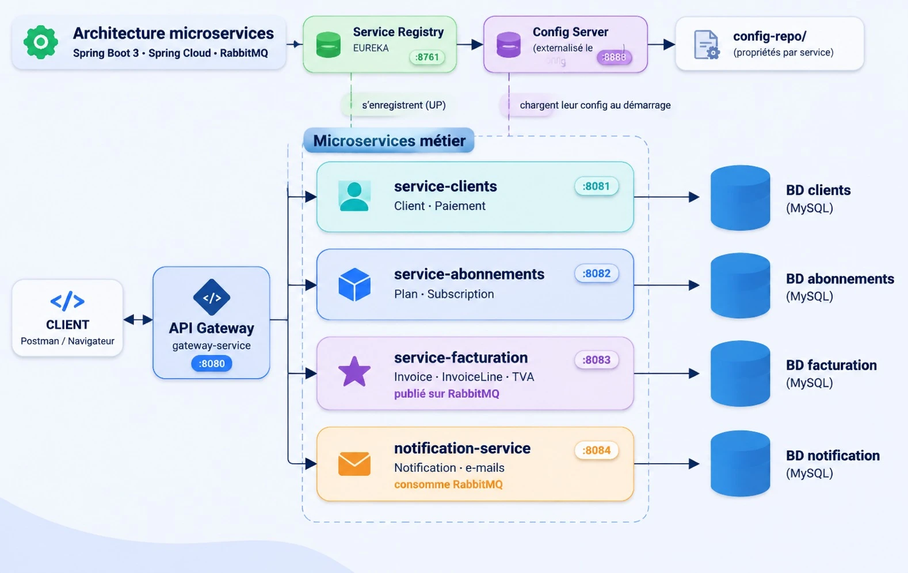
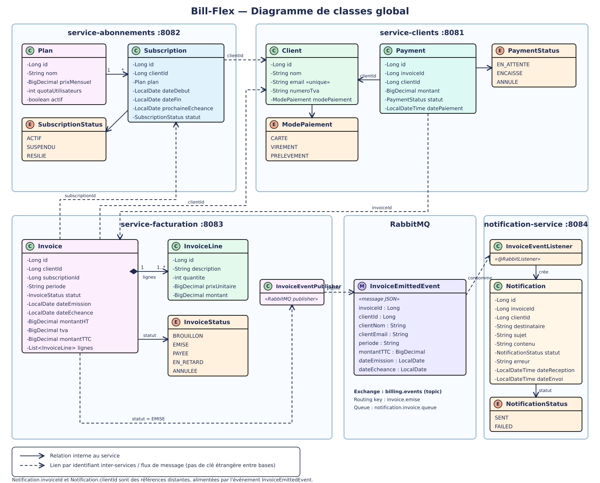

# Bill-Flex — Billing Microservices

Plateforme de facturation en **architecture microservices** : gestion des clients et paiements, abonnements et plans,
facturation avec TVA, et notifications e-mail asynchrones.

**Stack** : Java 17 · Spring Boot 3.3.5 · Spring Cloud 2023.0.3 · Maven multi-modules · MySQL 8.4 · RabbitMQ · MailHog · Docker Compose.

---

## Sommaire

1. [Architecture](#1-architecture)
2. [Ports utilisés](#2-ports-utilisés)
3. [Modules](#3-modules)
4. [Diagramme de classes global](#4-diagramme-de-classes-global)
5. [Prérequis](#5-prérequis)
6. [Démarrage pas à pas](#6-démarrage-pas-à-pas)

---

## 1. Architecture



> Flux : le client appelle la **Gateway (:8080)** ; les services s'enregistrent dans **Eureka (:8761)** et chargent leur
> configuration depuis le **Config Server (:8888)** ; chaque service a sa base **MySQL (:3306)** ; la facturation publie sur
> **RabbitMQ (:5672)** et la notification envoie les e-mails via **MailHog (SMTP :1025)**.

**Principes**

- **Database per Service** : chaque service a sa base MySQL et son utilisateur dédié, sans accès aux autres bases.
- **Références distantes = identifiants** (`clientId`, `subscriptionId`, `invoiceId`) : pas de clé étrangère entre bases ;
  la validation se fait par **OpenFeign** à la création.
- **Aucune URL en dur** entre services : les noms (`service-clients`…) sont résolus par Eureka.
- **Asynchrone** : la facturation publie un événement RabbitMQ, elle ne connaît pas le service de notification.
- **Couches** : `Controller → Service → Repository → Entity` + DTO.

---

## 2. Ports utilisés

| Composant | Port | Accès |
|---|---|---|
| API Gateway (`gateway-service`) | **8080** | <http://localhost:8080> |
| service-clients | **8081** | <http://localhost:8081> |
| service-abonnements | **8082** | <http://localhost:8082> |
| service-facturation | **8083** | <http://localhost:8083> |
| notification-service | **8084** | <http://localhost:8084> |
| Eureka (`discovery-service`) | **8761** | <http://localhost:8761> |
| Config Server | **8888** | <http://localhost:8888/service-clients/default> |
| MySQL | **3306** | `localhost:3306` |
| RabbitMQ (AMQP) | **5672** | broker |
| RabbitMQ (interface web) | **15672** | <http://localhost:15672> (guest / guest) |
| MailHog (SMTP) | **1025** | serveur SMTP de test |
| MailHog (interface web) | **8025** | <http://localhost:8025> |

---

## 3. Modules

| Module | `spring.application.name` | Port | Rôle | Base |
|---|---|---|---|---|
| `eureka` | `discovery-service` | 8761 | Annuaire des services | – |
| `config-server` | `config-server` | 8888 | Sert la configuration du dépôt Git `config-repo` | – |
| `gateway1` | `gateway-service` | 8080 | Point d'entrée unique, routage + load balancing | – |
| `service-clients` | `service-clients` | 8081 | CRUD `Client`, `Payment` (encaisser / annuler) | `billing_clients` |
| `service-abonnements` | `service-abonnements` | 8082 | CRUD `Plan`, `Subscription` (résilier) | `billing_abonnements` |
| `service-facturation` | `service-facturation` | 8083 | `Invoice` / `InvoiceLine`, états, HT/TVA/TTC, publisher RabbitMQ | `billing_facturation` |
| `notification-service` | `notification-service` | 8084 | Consumer RabbitMQ, envoi d'e-mails, historique | `billing_notifications` |

Autres dossiers : `database/init-mysql.sh` (création des bases et utilisateurs),
`postman/` (collection de tests), `docker-compose.yml`, `.env.example`.

---

## 4. Diagramme de classes global

Diagramme aligné sur les entités du code (`model/` de chaque service), notification-service inclus.
Trait plein : relation **interne** au service ; pointillé : **lien par identifiant** entre services (aucune clé étrangère
entre bases, validation par OpenFeign) ou flux de message RabbitMQ.



**Contraintes à retenir**

- `Invoice` : unicité `(subscriptionId, periode)` → une seule facture par abonnement et par période (idempotence).
- `Invoice.statut` suit une machine à états : BROUILLON → EMISE → PAYEE / EN_RETARD, ANNULEE possible avant paiement (`InvoiceStatus.canTransitionTo`).
- `Payment.clientId` référence un `Client` **local** ; `Payment.invoiceId` référence une facture **distante** (service-facturation).
- `Notification.invoiceId` / `clientId` sont des références distantes, alimentées par `InvoiceEmittedEvent`.

---

## 5. Prérequis

| Outil | Version | Usage |
|---|---|---|
| JDK | 17 | compilation et exécution |
| Maven | 3.9+ (ou `mvnw` fourni dans certains modules) | build |
| Docker Desktop | récent | MySQL, RabbitMQ, MailHog |
| Postman | récent | tests de l'API |
| IntelliJ IDEA | recommandé | ouvrir le `pom.xml` racine |

---

## 6. Démarrage pas à pas

### 6.1 Récupérer et compiler

```bash
git clone https://github.com/houdachiker/Projet-bill-flex.git
cd Projet-bill-flex
mvn clean package -DskipTests
```

### 6.2 Infrastructure Docker (MySQL, RabbitMQ, MailHog)

```bash
cp .env.example .env      # Windows PowerShell : Copy-Item .env.example .env
# Éditer .env et remplacer tous les mots de passe d'exemple
docker compose up -d
```

Le script `database/init-mysql.sh` crée au premier démarrage du volume les 4 bases (`billing_clients`,
`billing_abonnements`, `billing_facturation`, `billing_notifications`) et un utilisateur par base.

Variables de `.env` : `MYSQL_ROOT_PASSWORD`, `DB_CLIENTS_PASSWORD`, `DB_ABONNEMENTS_PASSWORD`,
`DB_FACTURATION_PASSWORD`, `DB_NOTIFICATIONS_PASSWORD`. Ne jamais commiter `.env`.

### 6.3 Mots de passe côté applications

Les services lisent leur mot de passe MySQL via variable d'environnement (à définir aussi dans la configuration
d'exécution IntelliJ ou dans le terminal avant `mvn spring-boot:run`) :

| Service | Utilisateur / base | Variable |
|---|---|---|
| service-clients | `billing_clients` | `DB_CLIENTS_PASSWORD` |
| service-abonnements | `billing_abonnements` | `DB_ABONNEMENTS_PASSWORD` |
| service-facturation | `billing_facturation` | `DB_FACTURATION_PASSWORD` |
| notification-service | `billing_notifications` | `DB_NOTIFICATIONS_PASSWORD` |

`MYSQL_HOST` et `MYSQL_PORT` valent par défaut `localhost` et `3306`.

### 6.4 Ordre de démarrage des applications

| # | Module | Vérifier que… |
|---|---|---|
| 1 | `eureka` | <http://localhost:8761> s'affiche |
| 2 | `config-server` | <http://localhost:8888/service-clients/default> renvoie du JSON |
| 3 | `service-clients`, `service-abonnements`, `service-facturation`, `notification-service` | ils sont **UP** dans Eureka |
| 4 | `gateway1` | <http://localhost:8080/clients> répond |
